# quantlab

A post-training weight quantization library for language models, written from scratch in raw PyTorch without relying on prebuilt quantization packages (`bitsandbytes`, `torch.ao`, `optimum`, `auto-gptq`, or `awq`).

## Architecture & Class Diagram

```mermaid
classDiagram
    class QuantParamsStrategy {
        <<interface>>
        +compute(weight, bits, group_size)
    }
    class SymmetricParamsStrategy {
        +compute(weight, bits, group_size)
    }
    class AsymmetricParamsStrategy {
        +compute(weight, bits, group_size)
    }
    QuantParamsStrategy <|-- SymmetricParamsStrategy
    QuantParamsStrategy <|-- AsymmetricParamsStrategy

    class Packer {
        <<interface>>
        +pack(codes, bits)
        +unpack(packed, bits, count)
    }
    class BitPacker {
        +pack(codes, bits)
        +unpack(packed, bits, count)
    }
    Packer <|-- BitPacker

    class Dequantizer {
        <<interface>>
        +dequantize(codes, scale, zero_point, bits)
    }
    class LinearDequantizer {
        +dequantize(codes, scale, zero_point, bits)
    }
    Dequantizer <|-- LinearDequantizer

    class Quantizer {
        <<interface>>
        +quantize(model)
    }
    class SimulatedRTNQuantizer {
        -QuantConfig config
        +quantize(model)
    }
    class RTNQuantizer {
        -QuantConfig config
        -BitPacker packer
        +quantize(model)
    }
    Quantizer <|-- SimulatedRTNQuantizer
    Quantizer <|-- RTNQuantizer
    RTNQuantizer *-- BitPacker

    class QuantizedLinear {
        +Tensor packed_weight
        +Tensor scales
        +Tensor zero_points
        -BitPacker _packer
        -LinearDequantizer _dequantizer
        +forward(x)
    }
    QuantizedLinear *-- BitPacker
    QuantizedLinear *-- LinearDequantizer

    class TextDataset {
        <<interface>>
        +__len__()
        +__getitem__(idx)
    }
    class WikiText2Dataset {
        +__len__()
        +__getitem__(idx)
    }
    TextDataset <|-- WikiText2Dataset

    class Metric {
        <<interface>>
        +measure(model)
    }
    class PerplexityMetric {
        +measure(model, dataset)
    }
    class WeightErrorMetric {
        -WeightSnapshot snapshot
        +measure(model)
    }
    Metric <|-- PerplexityMetric
    Metric <|-- WeightErrorMetric

    class Exporter {
        <<interface>>
        +export(model, config, out_dir)
    }
    class NativeExporter {
        +export(model, config, out_dir, source_dir)
    }
    Exporter <|-- NativeExporter

    class TemplateExporter {
        <<interface>>
        +export(config, out_path)
    }
    class GGUFExporter {
        +export(config, out_path)
    }
    TemplateExporter <|-- GGUFExporter
```



## Package Tree

```text
quantlab/
├── pyproject.toml
├── LICENSE
├── README.md
├── src/
│   └── quantlab/
│       ├── __init__.py
│       ├── interfaces.py
│       ├── config.py
│       ├── grouping.py
│       ├── symmetric_params.py
│       ├── asymmetric_params.py
│       ├── bit_packer.py
│       ├── linear_dequantizer.py
│       ├── quantized_linear.py
│       ├── rtn_quantizer.py
│       ├── simulated_quantizer.py
│       ├── snapshot.py
│       ├── wikitext2_dataset.py
│       ├── perplexity_metric.py
│       ├── weight_error_metric.py
│       ├── model_size_metric.py
│       ├── native_exporter.py
│       ├── native_loader.py
│       └── gguf_exporter.py
├── examples/
│   └── small_tensor_demo.py
├── phone/
│   └── chat.py
└── tests/
    ├── __init__.py
    ├── conftest.py
    ├── test_config.py
    ├── test_grouping.py
    ├── test_params.py
    ├── test_bit_packer.py
    ├── test_dequantizer.py
    ├── test_quantized_linear.py
    ├── test_quantizers.py
    ├── test_metrics.py
    ├── test_model_size_metric.py
    ├── test_native_export_load.py
    ├── test_gguf_exporter.py
    └── test_phone_chat.py
```

## 10-Line Usage Example

```python
from transformers import AutoModelForCausalLM
from quantlab import Granularity, Mode, QuantConfig, RTNQuantizer, measure_size

model = AutoModelForCausalLM.from_pretrained("TinyLlama/TinyLlama-1.1B-Chat-v1.0")
cfg = QuantConfig(bits=4, mode=Mode.SYMMETRIC, granularity=Granularity.GROUP, group_size=32)
quantizer = RTNQuantizer(config=cfg, skip_names=("lm_head",))
quantized_model = quantizer.quantize(model)
report = measure_size(quantized_model)
print(f"Quantized to {report.total_mb:.1f} MB ({report.reduction_vs_fp16_pct:.1f}% reduction)")
```

## Quantization Math in Plain Text

Post-training quantization projects continuous floating-point weights into discrete low-bit integer bins.

### Symmetric Quantization
- Code bounds: qmax = 2^(bits - 1) - 1, qmin = -qmax.
- Scale: scale = max(|w|) / qmax computed per group (tensor, channel, or group of size N).
- Scale rounding: scale is rounded to float16 precision before quantization.
- Quantization formula: q = clamp(round(w / scale), qmin, qmax).
- Zero point: zero_point = 0 (symmetric around zero; no zero point stored).
- Dequantization formula: w_hat = scale * q.

### Asymmetric Quantization
- Code bounds: qmin = 0, qmax = 2^bits - 1.
- Range widening: w_min = min(min(w), 0), w_max = max(max(w), 0).
- Scale: scale = (w_max - w_min) / (2^bits - 1), rounded to float16.
- Zero point: zero_point = clamp(round(-w_min / scale), 0, 2^bits - 1).
- Quantization formula: q = clamp(round(w / scale) + zero_point, qmin, qmax).
- Dequantization formula: w_hat = scale * (q - zero_point).

### Error Invariant
For any weight value within the clipping range, rounding error is bounded by:
|w - w_hat| <= scale / 2.
Constant and all-zero groups are assigned scale = 1.0 to avoid division by zero without NaN.
